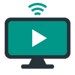

# ioBroker.androidtv – Anleitung

Steuere deine **NVIDIA SHIELD**, andere **Android-TV- / Google-TV-Geräte** und **Amazon Fire TV** aus ioBroker: ein- und ausschalten, Apps starten, Fernbedienungstasten drücken und sehen, was gerade läuft.

Produktseiten: [NVIDIA SHIELD TV](https://www.nvidia.com/de-de/shield/), [Android TV / Google TV](https://www.android.com/intl/de_de/tv/), [Amazon Fire TV](https://www.amazon.de/firetv).

## Was du damit machen kannst

- Gerät ein- und ausschalten und sehen, ob es an ist
- Sehen, welche App gerade läuft
- Apps per Klick starten (Netflix, YouTube, Prime Video, Disney+ …)
- Jede Taste der Fernbedienung drücken (Home, Zurück, Pfeiltasten, Play/Pause, Lautstärke …)
- Text in Suchfelder schreiben
- Sehen, was läuft: Titel, Play/Pause und Position (optional, siehe Schritt 2b)

## Voraussetzungen

- ioBroker mit Node.js 22 oder neuer, js-controller 6.0.11 oder neuer und Admin 7.6.20 oder neuer
- Das Gerät ist in deinem Heimnetz und ioBroker kann es erreichen (getrennte Netze oder Firewall: siehe [Für Fortgeschrittene](#für-fortgeschrittene))
- Kein Cloud-Konto und keine zusätzliche App nötig

## Welchen Gerätetyp wähle ich?

| Dein Gerät | Gerätetyp in den Einstellungen | Was du einmalig machst |
| --- | --- | --- |
| NVIDIA SHIELD, Chromecast mit Google TV, Google TV Streamer, Fernseher mit Android TV / Google TV (Sony, Philips, TCL …) | **Android TV / Google TV** | einen Code vom Fernseher eingeben |
| wie oben, und du möchtest auch Titel und Play/Pause sehen | **Android TV / Google TV + Wiedergabe-Infos** | Code eingeben + eine Einstellung am Gerät einschalten |
| Amazon Fire TV (Stick, Cube, Fernseher mit Fire TV) | **Amazon Fire TV** | eine Einstellung am Gerät einschalten |

## Einrichtung Schritt für Schritt

### 1. Gerät hinzufügen

1. Adapter installieren und die Instanz-Einstellungen öffnen.
2. Reiter **Geräte**: auf **+** klicken.
3. Einen **Namen** (z. B. „Wohnzimmer“) und die **IP-Adresse** des Geräts eintragen. Die IP-Adresse steht in den Netzwerkeinstellungen des Geräts.
   Tipp: Gib dem Gerät im Router eine feste IP-Adresse, sonst bekommt es später womöglich eine andere.
4. Den **Gerätetyp** wählen (siehe Tabelle oben) und **Speichern** klicken.

### 2a. Android TV / Google TV / SHIELD: einmal koppeln

1. Gerät einschalten.
2. Im Geräte-Eintrag auf **Kopplung starten** klicken. Auf dem Fernseher erscheint ein 6-stelliger Code.
3. Code eingeben und **Code bestätigen** klicken (innerhalb etwa einer Minute).

Fertig – der Status im Eintrag zeigt **Verbunden**. Das ist nur einmal nötig (erneut nur nach dem Zurücksetzen des Geräts).

### 2b. Optional: Titel und Play/Pause anzeigen

Gerätetyp **Android TV / Google TV + Wiedergabe-Infos** wählen und am Gerät das *Netzwerk-Debugging* einschalten:

1. An der SHIELD **Einstellungen › Geräteeinstellungen › Entwickleroptionen** öffnen und **Netzwerk-Debugging** einschalten.
   Gibt es keine Entwickleroptionen: **Einstellungen › Geräteeinstellungen › Info** öffnen und 7× auf **Build** klicken.
2. Die Adapter-Einstellungen speichern.
3. Der Fernseher fragt **„Debugging zulassen?“** – **Immer zulassen** anhaken und bestätigen.

Der Status zeigt **Verbunden · Wiedergabe-Infos aktiv**.

### 2c. Amazon Fire TV

1. Am Fire TV **Einstellungen › Mein Fire TV › Entwickleroptionen** öffnen und **ADB-Debugging** einschalten.
   Gibt es keine Entwickleroptionen: **Einstellungen › Mein Fire TV › Info** öffnen und 7× auf den Gerätenamen klicken.
2. Gerätetyp **Amazon Fire TV** wählen und speichern.
3. Der Fernseher fragt **„USB-Debugging zulassen?“** – **Von diesem Computer immer zulassen** anhaken und bestätigen.

Der Status zeigt **Verbunden**. Beim Fire TV ist kein Code nötig.

> **Hinweis zum Debugging (2b und 2c):** Solange das Debugging eingeschaltet ist, können auch andere Geräte in deinem Heimnetz auf den Fernseher zugreifen. Nur im eigenen, vertrauenswürdigen Netz verwenden.

### 3. Optional: aus dem tiefen Standby einschalten (Wake-on-LAN)

Manche Geräte (z. B. Fire TV) schalten im tiefen Standby ihr Netzwerk ab. ioBroker kann sie trotzdem wecken:

1. Am Gerät **Wake on LAN** bzw. **Netzwerk-Standby** einschalten (der Name hängt vom Gerät ab).
2. Im Geräte-Eintrag die **MAC-Adresse** eintragen. Am besten aus der Geräteliste deines Routers; bei Kabelverbindung ist es die MAC der LAN-Schnittstelle.

## Bedienung

Jedes Gerät findest du in den Objekten unter `androidtv.0.<Name>`. Die wichtigsten Datenpunkte:

| Was | Datenpunkt |
| --- | --- |
| Ein-/ausschalten, ist es an? | `power` (true = an) |
| Welche App läuft? | `currentApp` (App-Kennung, z. B. `com.netflix.ninja`) |
| App starten | Knöpfe in `apps` (z. B. `apps.Netflix`) |
| Tasten der Fernbedienung | Knöpfe in `keys` (z. B. `keys.home`, `keys.playPause`, `keys.volumeUp`) |
| Text eingeben | Text in `sendText` schreiben |
| Was läuft gerade? (mit Wiedergabe-Infos / Fire TV) | `media.title`, `media.state` (play / pause), `media.position` (Sekunden) |
| Verbunden? | `info.connected`, lesbarer Status in `info.status` |

Diese Datenpunkte nutzt du in Skripten, Blockly, Szenen oder Visualisierungen wie jeden anderen Datenpunkt. Beispiel: `false` in `power` schreiben, um den Fernseher nachts auszuschalten.

## App-Favoriten

Im Reiter **App-Favoriten** legst du fest, welche App-Knöpfe bei jedem Gerät angelegt werden. Name und den **Web-Link** oder die **App-Kennung** eintragen.

| App | Android TV / SHIELD | Fire TV |
| --- | --- | --- |
| Netflix | `https://www.netflix.com/title` | `https://www.netflix.com/title` |
| YouTube | `https://www.youtube.com` | `https://www.youtube.com` |
| Disney+ | `https://www.disneyplus.com` | `https://www.disneyplus.com` |
| Prime Video | `https://app.primevideo.com` | `com.amazon.firebat` |
| Amazon Music | – | `com.amazon.bueller.music` |
| Emby | `com.mb.android` (mit *+ Wiedergabe-Infos*) | `com.mb.android` |

- Ein Web-Link öffnet direkt die passende App.
- Eine App-Kennung funktioniert beim Fire TV und mit dem Gerätetyp *+ Wiedergabe-Infos*.
- Würde ein Link nur den Webbrowser öffnen, startet der Adapter ihn nicht und schreibt einen Hinweis ins Log – dann die App-Kennung verwenden.

**App-Kennung herausfinden:** Die App am Fernseher mit der Fernbedienung starten und `currentApp` ablesen.

Tipp: Ein Link kann auch direkt ein bestimmtes Video öffnen, z. B. `https://www.youtube.com/watch?v=…`. YouTube fragt eventuell zuerst nach dem Profil.

## Probleme & Lösungen

- **Status „Kopplung erforderlich“**: Gerät einschalten und neu koppeln (Schritt 2a). Nötig nach dem Zurücksetzen des Geräts.
- **„Das Gerät ist zum Koppeln nicht erreichbar“**: IP-Adresse prüfen und ob das Gerät an ist. Ein Fire TV lässt sich nicht koppeln – dort den Gerätetyp *Amazon Fire TV* wählen.
- **Status „Bitte am Fernseher Debugging zulassen bestätigen“**: Die Frage auf dem Fernseher bestätigen und *Immer zulassen* anhaken.
- **Status „Nicht verbunden“**: Das Gerät ist aus, ohne Strom oder nicht erreichbar. Der Adapter verbindet sich automatisch neu, sobald es wieder da ist.
- **Das Gerät lässt sich nach einiger Zeit nicht mehr aus ioBroker einschalten**: Es ist im tiefen Standby ohne Netzwerk – Wake-on-LAN einrichten (Schritt 3). Die MAC-Adresse aus dem Router nehmen, nicht aus `info.mac`: Das Gerät meldet dort eventuell die MAC seines WLANs, auch wenn es per Kabel verbunden ist. Sind ioBroker und Fernseher in verschiedenen Netzen, in den Experteneinstellungen die Broadcast-Adresse des Fernseher-Netzes eintragen (z. B. `192.168.20.255`).
- **„Ausschalten“ im Menü des Geräts**: Damit fährt das Gerät ganz herunter, nicht in den Standby. Einschalten geht dann nur noch mit der eigenen Fernbedienung oder dem Ein-Schalter.
- **Die SHIELD schaltet sich nach dem Ausschalten sofort wieder ein**: Der Fernseher weckt sie per HDMI-CEC, solange er noch ihren HDMI-Eingang zeigt. Den Fernseher vorher auf einen anderen Eingang oder eine App umschalten oder den Fernseher ausschalten – die SHIELD geht dann von selbst in den Standby.
- **Der Fernseher zeigt ständig „Tastatur auf Mobilgerät verwenden“**: In den Instanz-Einstellungen den Expertenmodus einschalten und beim Gerät *Aktuelle App & Texteingabe* abwählen.
- **Ein App-Knopf tut nichts**: Manche Apps lassen sich an der SHIELD ohne Wiedergabe-Infos nicht per App-Kennung starten. Den Web-Link verwenden oder *+ Wiedergabe-Infos* wählen.
- **Lautstärke zeigt nichts an**: Wird die Lautstärke über Fernseher oder AV-Receiver geregelt (HDMI-CEC), kann das Gerät sie nicht melden. Die Lautstärke-Tasten funktionieren trotzdem.
- **Prime Video zeigt als Titel nur „PrimeVideo“**: Die App gibt den Titel des Films nicht an das System weiter. Play/Pause und Position funktionieren.

## Für Fortgeschrittene

Technische Details

- **Android TV / Google TV**: Android TV Remote Protokoll v2 (wie die Google-TV-App), TCP 6466/6467, TLS mit einem vom Adapter erzeugten Client-Zertifikat. Benötigt die System-App *Android TV Remote Service* (auf fast allen Android-TV-Geräten vorinstalliert, fehlt beim Fire TV). Ein/Aus, aktuelle App und Lautstärke meldet das Gerät selbst – keine Abfragen.
- **Wiedergabe-Infos / Fire TV**: ADB-Netzwerk-Debugging, TCP 5555 (klassisch, nicht „Wireless Debugging“ mit Kopplungscode). Im Adapter umgesetzt, kein adb-Programm nötig. Das Gerät wird nur abgefragt, solange es an ist (Standard alle 5 s, Option *Wiedergabe-Infos aktualisieren alle*).
- Befehle laufen automatisch über den passenden Weg: Web-Links und Tasten über das Remote-Protokoll (schnell), App-Kennungen über ADB. Tasten über ADB brauchen am Fire TV etwa 1 s.
- Client-Zertifikat und ADB-Schlüssel liegen verschlüsselt im Dateispeicher der Instanz (`androidtv.0/client-certificate.json`, `androidtv.0/adb-key.json`).
- Firewall / VLAN: ioBroker muss das Gerät auf TCP 6466, 6467 (Remote) bzw. 5555 (ADB) erreichen, IPv4 und ggf. IPv6. Wake-on-LAN sendet UDP-Pakete an Port 9 (Broadcast und Geräte-IP).
- Neuverbindung: nach 2 s, dann mit wachsendem Abstand bis zum *maximalen Abstand für Neuverbindung* (Expertenoption, Standard 60 s). Verbindungsfehler stehen nur im Debug-Log. Ein Gerät, das 30 s lang nicht erreichbar ist, wird auf `power = false` gesetzt.
- Titel und Untertitel stammen aus der Media-Session der App. Apps, die sie nicht füllen, zeigen nur ihren Namen (z. B. Prime Video an Fire TV und SHIELD: „PrimeVideo“) oder nichts.
- Alle Datenpunkte und bekannte Einschränkungen: siehe [README (englisch)](../../README.md#technical-details).

## Unterstützung

Der Adapter ist kostenlos und bleibt kostenlos. Wenn er dir nützt und du Danke sagen möchtest, kannst du die Entwicklung unterstützen:

Fehlermeldungen und Ideen in den [Issues](https://github.com/Schimi1983/ioBroker.androidtv/issues) helfen genauso. Fragen und Testberichte: [ioBroker-Forum](https://forum.iobroker.net/topic/85827/test-adapter-androidtv-v0.2.x-latest).
