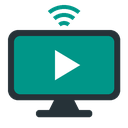

# ioBroker.androidtv – Anleitung

Steuere deine **NVIDIA SHIELD**, andere **Android-TV- / Google-TV-Geräte** und **Amazon Fire TV** aus ioBroker: ein- und ausschalten, Apps starten, Fernbedienungstasten drücken und sehen, was gerade läuft.

Produktseiten: [NVIDIA SHIELD TV](https://www.nvidia.com/de-de/shield/), [Android TV / Google TV](https://www.android.com/intl/de_de/tv/), [Amazon Fire TV](https://www.amazon.de/firetv).

**Voraussetzungen:** Node.js 22, js-controller 6.0.11 und Admin 7.6.20 oder neuer. ioBroker muss das Gerät im Netzwerk erreichen. Kein Cloud-Konto nötig.

## Einrichtung

### 1. Gerät hinzufügen

Instanz-Einstellungen › Reiter **Geräte** › im Gerätemanager **Gerät hinzufügen**: Namen und **IP-Adresse** des Geräts eintragen (steht in den Netzwerkeinstellungen des Geräts; am besten im Router eine feste IP vergeben). Dann den **Gerätetyp** wählen:

| Gerätetyp | Für | Was geht | Was du einmalig machst |
| --- | --- | --- | --- |
| **Android TV / Google TV – Standard** | NVIDIA SHIELD, Chromecast mit Google TV, Fernseher mit Android TV / Google TV | Ein/Aus, Apps, Fernbedienungstasten, Lautstärke | einmal mit dem Code vom Fernseher koppeln |
| **Android TV / Google TV – mit Titel und Play/Pause (ADB nötig)** | dieselben Geräte | alles oben + Titel, Play/Pause, Position | einmal koppeln, dann *Netzwerk-Debugging* einschalten |
| **Amazon Fire TV** | Fire TV Stick, Cube, Fernseher mit Fire TV | Ein/Aus, Apps, Fernbedienungstasten, Titel, Play/Pause | am Gerät *ADB-Debugging* einschalten |

Unsicher? Mit **Standard** anfangen – umstellen geht jederzeit. Der Gerätemanager speichert Geräte weiterhin im bestehenden Feld `native.devices`. Beim Hinzufügen, Speichern einer Änderung oder Entfernen wird dieses Feld aktualisiert und der Adapter automatisch neu gestartet; vorhandene Geräte bleiben erhalten.

### 2. Verbinden

**Standard:** Gerät einschalten, beim Gerät im Gerätemanager die Aktion **Gerät koppeln** wählen, den 6-stelligen Code vom Fernseher eingeben und im Dialog bestätigen. Fertig – der Status zeigt **Verbunden**.

**Mit Titel und Play/Pause:** wie oben koppeln. Dann am Gerät **Einstellungen › Geräteeinstellungen › Entwickleroptionen** öffnen und **Netzwerk-Debugging** einschalten (keine Entwickleroptionen? *Info* › 7× auf **Build** klicken). Am Fernseher **„Debugging zulassen?“** mit **Immer zulassen** bestätigen.

**Amazon Fire TV:** am Fire TV **Einstellungen › Mein Fire TV › Entwickleroptionen** öffnen und **ADB-Debugging** einschalten (keine Entwickleroptionen? *Info* › 7× auf den Gerätenamen klicken). Am Fernseher **„USB-Debugging zulassen?“** mit **Immer zulassen** bestätigen.

> Mit ADB (Debugging) können auch andere Geräte in deinem Netz auf den Fernseher zugreifen. Nur im eigenen, vertrauenswürdigen Netz verwenden.

### 3. Optional: aus dem tiefen Standby einschalten

Manche Geräte (z. B. Fire TV) schalten im tiefen Standby ihr Netzwerk ab. Am Gerät **Wake on LAN** / **Netzwerk-Standby** einschalten und im Gerätemanager-Formular die **MAC-Adresse** eintragen – am besten aus dem Router (bei Kabel: die MAC der LAN-Schnittstelle).

## Bedienung

Jedes Gerät erscheint als `androidtv.0.<Name>`:

| Was | Datenpunkt |
| --- | --- |
| Ein-/ausschalten, ist es an? | `power` |
| Welche App läuft? | `currentApp` (z. B. `com.netflix.ninja`) |
| App starten | Knöpfe in `apps` |
| Fernbedienungstasten | Knöpfe in `keys` (z. B. `keys.home`, `keys.playPause`, `keys.volumeUp`) |
| Text eingeben | `sendText` |
| Was läuft gerade? | `media.title`, `media.state`, `media.position` (nicht bei *Standard*) |
| Verbunden? | `info.connected`, lesbarer Status in `info.status` |

Diese Datenpunkte nutzt du in Skripten, Blockly, Szenen oder Visualisierungen wie jeden anderen.

### App-Favoriten

Reiter **App-Favoriten**: Jeder Eintrag wird bei jedem Gerät zu einem Knopf. Den **Web-Link** oder die **App-Kennung** der App eintragen (App am Fernseher starten und `currentApp` ablesen).

| App | Android TV / SHIELD | Fire TV |
| --- | --- | --- |
| Netflix | `https://www.netflix.com/title` | gleich |
| YouTube | `https://www.youtube.com` | gleich |
| Disney+ | `https://www.disneyplus.com` | gleich |
| Prime Video | `https://app.primevideo.com` | `com.amazon.firebat` |

App-Kennungen funktionieren beim Fire TV und mit dem Gerätetyp *mit Titel und Play/Pause*. Ein Link, der nur den Webbrowser öffnen würde, wird nicht gestartet (Hinweis im Log).

## Probleme & Lösungen

- **„Kopplung erforderlich“**: neu koppeln (Schritt 2) – nötig nach dem Zurücksetzen des Geräts.
- **„Nicht verbunden“**: Das Gerät ist aus oder nicht erreichbar. Der Adapter verbindet sich von selbst neu.
- **Lässt sich nach einiger Zeit nicht mehr einschalten**: tiefer Standby – Wake-on-LAN einrichten (Schritt 3). Die MAC aus dem Router nehmen, nicht aus `info.mac` (das kann die WLAN-MAC sein). Verschiedene Netze: in den Experteneinstellungen die Broadcast-Adresse eintragen (z. B. `192.168.20.255`).
- **„Ausschalten“ im Menü des Geräts** fährt es ganz herunter – dann schaltet es nur noch die eigene Fernbedienung ein.
- **Die SHIELD schaltet sich nach dem Ausschalten wieder ein**: Der Fernseher weckt sie per HDMI-CEC, solange er ihren Eingang zeigt. Vorher auf einen anderen Eingang umschalten oder den Fernseher ausschalten.
- **Der Fernseher zeigt ständig „Tastatur auf Mobilgerät verwenden“**: Expertenmodus › beim Gerät *Aktuelle App & Texteingabe* abwählen.
- **Lautstärke zeigt nichts an**: Die Lautstärke regelt der Fernseher / AV-Receiver (HDMI-CEC); die Lautstärke-Tasten funktionieren trotzdem.
- **Kein Titel bei Netflix oder Prime Video** (Prime Video zeigt nur „PrimeVideo“): Diese Apps geben den Titel nicht an Android weiter; Play/Pause und Position funktionieren. YouTube zeigt Titel und Kanal.

Technische Details, alle Datenpunkte und bekannte Einschränkungen: [README (englisch)](../../README.md#technical-details).

## Unterstützung

Der Adapter ist kostenlos. Wer Danke sagen möchte:  

Fehler und Ideen: [Issues](https://github.com/Schimi1983/ioBroker.androidtv/issues) · Fragen und Testberichte: [ioBroker-Forum](https://forum.iobroker.net/topic/85827/test-adapter-androidtv-v0.2.x-latest)
